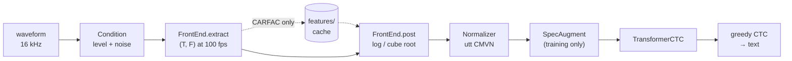

# asr-perceptual-experiments

**asrlib** is a small Python library for one question:

> Does a cochlear model (**CARFAC**) make a better speech-recognition front end than the
> usual **log-mel** and **MFCC** features, especially in **noise** and at **unusual loudness**?

The library wraps a whole speech recognizer (front end → normalization → Transformer-CTC
model → text) in one class, `ASR`. You describe an experiment with a frozen config, and
`ASR` handles data download, feature extraction and caching, noise mixing, training with
resume, transcription and evaluation with confidence intervals. Swapping the front end
changes one line. The library checks that everything else stays the same, so comparisons
are fair.

Part of Eric Oliveira's ECE thesis at Northwestern University.

---

## Contents

1. [Quick start](#1-quick-start)
2. [Installation](#2-installation)
3. [The workspace folder](#3-the-workspace-folder)
4. [How it fits together](#4-how-it-fits-together)
5. [Configuring an experiment](#5-configuring-an-experiment)
6. [Front ends](#6-front-ends)
7. [Conditions: loudness and noise](#7-conditions-loudness-and-noise)
8. [Data and batching](#8-data-and-batching)
9. [The model](#9-the-model)
10. [Training](#10-training)
11. [Saved models and naming](#11-saved-models-and-naming)
12. [Transcribing](#12-transcribing)
13. [Evaluation and statistics](#13-evaluation-and-statistics)
14. [Comparing front ends fairly](#14-comparing-front-ends-fairly)
15. [Feature cache](#15-feature-cache)
16. [Running on Quest (Slurm)](#16-running-on-quest-slurm)
17. [Extending the library](#17-extending-the-library)
18. [Testing](#18-testing)
19. [Troubleshooting](#19-troubleshooting)
20. [Repository layout](#20-repository-layout)
21. [Roadmap](#21-roadmap)
22. [License and references](#22-license-and-references)

---

## 1. Quick start

```python
from asrlib import ASR, ASRConfig, LogMelConfig, CarfacConfig, DataConfig, Condition, CLEAN

# Log-mel features, about 28 h of LibriSpeech train-clean-100, seed 1
cfg = ASRConfig(frontend=LogMelConfig(), data=DataConfig(n_train_shards=4), seed=1)
asr = ASR(cfg, root="~/asr_workspace", device="cuda")

asr.sanity_check()                    # Shapes + overfit one batch (a few seconds)
asr.fit()                             # Trains; best model -> models/<name>.pt
asr.transcribe("clip.wav")            # -> "he hoped there would be stew for dinner"

# Test under several conditions at once -> pandas DataFrame
table = asr.benchmark([CLEAN, Condition("white", 10), Condition("white", 0)])

# The same experiment with CARFAC instead: one line
carfac = asr.with_changes(frontend=CarfacConfig())
```

For a ready-made first experiment, open **`main.py`** in the repo root. All settings are
global constants at the top, so you can set them and press **Run** in VS Code (see
[§16](#16-running-on-quest-slurm)).

---

## 2. Installation

Requires **Python 3.11–3.13** (developed on 3.12).

```bash
git clone https://github.com/Eclo19/asr-perceptual-experiments.git
cd asr-perceptual-experiments

# conda (Mac / Quest)
conda create -n asr python=3.12 -y
conda activate asr

pip install -r requirements.txt     # Dependencies + CARFAC (JAX) at the pinned commit
pip install -e ".[dev,carfac]"      # asrlib itself, editable: code changes apply immediately
```

`pip install -e .` installs the package in **editable** mode: Python imports `asrlib`
straight from `src/asrlib/`, so `git pull` or an edit takes effect without reinstalling.
`[dev]` adds pytest, matplotlib and ipykernel. `[carfac]` adds CARFAC's JAX port at commit
`77d8a91` (the version this library was verified against).

### torch and torchaudio must match

`torch` and `torchaudio` must have **the same version and the same CUDA build**. Otherwise
importing torchaudio fails with errors such as `libcudart.so.13: cannot open shared object
file`. The known-good pair is **2.11.0** on both machines:

```bash
# Mac (CPU)
pip install torch==2.11.0 torchaudio==2.11.0

# Quest (CUDA 12.6 build; the A100 driver supports it)
pip install torch==2.11.0 torchaudio==2.11.0 --index-url https://download.pytorch.org/whl/cu126
pip uninstall -y torchvision        # Not needed; an unmatched version breaks imports
```

Check:

```bash
python -c "import torch, torchaudio; print(torch.__version__, torchaudio.__version__, torch.cuda.is_available())"
```

### Colab

```bash
pip install -e ".[dev]"
pip install "carfac @ git+https://github.com/google/carfac.git@77d8a91f24d2f5873783dc0ce767d32778b938bc#subdirectory=python"
```

This keeps Colab's own GPU builds of torch and JAX instead of replacing them with CPU builds.

### JAX on GPU (optional)

CARFAC only runs while the feature cache is being built ([§15](#15-feature-cache)).
Training never calls it, so CPU JAX is fine. To run CARFAC on the GPU as well:

```bash
pip install "jax[cuda12]==$(python -c 'import jax; print(jax.__version__)')"
```

asrlib sets `XLA_PYTHON_CLIENT_PREALLOCATE=false` before importing JAX, so JAX doesn't
reserve most of the GPU memory that PyTorch needs.

---

## 3. The workspace folder

Everything asrlib reads or writes lives under one **workspace root**:

```
<root>/
  datasets/    Speech corpora: local parquet copies, plus the Hugging Face cache (hf_cache/)
  features/    Cached features of expensive front ends (CARFAC)
  noise/       Noise recordings: noise/<kind>/*.wav, plus noise/splits.json
  models/      <name>.pt, <name>_meta.json (and <name>_last.pt while training)
  results/     <name>/per_utt/<split>__<condition>.csv
```

The root is chosen in this order:

1. the `root=` argument (`ASR(cfg, root=...)`, `Workspace(...)`);
2. the `ASRLIB_ROOT` environment variable;
3. the current working directory.

The folders are created automatically. `main.py` uses the **repo root** as the workspace.
These folders are listed in `.gitignore`, so the data never ends up in git.

> **Disk space:** LibriSpeech train-clean-100 is about 6.3 GB, and the CARFAC caches add a
> few GB per condition. On Quest, keep the workspace under `/projects/<allocation>/`, not in
> your small home folder.

```python
from asrlib import Workspace
ws = Workspace("~/asr_workspace")
ws.models, ws.find_models()           # Paths; meta files, newest first
```

---

## 4. How it fits together



| Piece | File | Job |
|---|---|---|
| `ASRConfig` and friends | `config.py` | **What the system is.** Frozen dataclasses with stable hashes |
| `ASR` | `asr.py` | Facade: builds everything from the config; `fit`, `transcribe`, `evaluate`, `save`, `load` |
| `FrontEnd` (`LogMel`, `MFCC`, `CARFAC`) | `frontends.py` | Waveform → features `f32[T, F]` at 100 frames/s |
| `Featurizer`, `Normalizer` | `features.py` | **The** feature pipeline, shared by training, evaluation and `transcribe()` |
| `Condition`, `NoiseBank` | `conditions.py` | Speech level (dB SPL) and noise mixing at a given SNR |
| `LibriSpeech`, `LocalFolderCorpus`, `FeatureDataset`, `LengthBucketSampler`, `collate` | `data.py` | Corpora, datasets and length-bucketed batches |
| `FeatureStore`, `CachedFeatures` | `cache.py` | On-disk feature cache for expensive front ends |
| `TransformerCTC` | `models.py` | Conv subsampling ×4 → Transformer encoder → CTC |
| `Trainer` | `train.py` | AdamW, warmup + cosine, AMP, early stopping, resumable state |
| `EvalResult`, `bootstrap_ci`, `paired_bootstrap`, `History` | `metrics.py` | WER/CER, confidence intervals, significance tests |
| `CharTokenizer` | `tokenizer.py` | Text ↔ ids (31 symbols) |
| `register`, `build` | `registry.py` | Build components by name, so new ones plug in without editing `ASR` |
| `Workspace` | `workspace.py` | The folder layout above |

**Design rules**

- **One feature pipeline.** Training, validation, test and `transcribe()` all call the same
  `Featurizer`, so features can't silently differ between training and inference.
- **The config is the identity.** Same config ⇒ same hash ⇒ same model name. `fit()` uses
  the hash to find and resume an unfinished run.
- **Configs are immutable.** To change something, make a new config (`cfg.replace(...)`)
  or a new system (`asr.with_changes(...)`). An `ASR` never changes its front end after
  construction.
- **Test conditions are not part of the config.** You train once, then evaluate under as
  many conditions as you like.

---

## 5. Configuring an experiment

An `ASRConfig` holds everything that defines a trained system:

```python
ASRConfig(
    frontend=LogMelConfig(),     # The variable being compared (with the seed)
    model=ModelConfig(),
    data=DataConfig(),
    train=TrainConfig(),
    norm="utt_cmvn",             # "utt_cmvn" or "none"
    tokenizer="char",
    seed=0,
)
```

All configs are `@dataclass(frozen=True)`. Any field you don't set keeps the default below.

### `DataConfig`

| Field | Default | Meaning |
|---|---|---|
| `corpus` | `"librispeech"` | Registry name of the corpus (`"librispeech"`, `"local_folder"`) |
| `train_split` | `"train.100"` | `"train.100"`, `"train.360"` (Hugging Face mirror names) |
| `n_train_shards` | `None` | Parquet shards to use: each is about 7 h. `None` = all 14 (about 100 h); `4` ≈ 28 h |
| `val_split` | `"validation"` | dev-clean; used to choose the best epoch |
| `test_split` | `"test"` | test-clean; the default for `evaluate()` |
| `source` | `"auto"` | `"auto"`: `datasets/<corpus>/<split>/*.parquet` if present, else Hugging Face. `"local"` / `"hf"` force one |
| `max_train_seconds` | `20.0` | Drops longer utterances from **training only**. `None` keeps all |

### `ModelConfig`

| Field | Default | Meaning |
|---|---|---|
| `arch` | `"transformer_ctc"` | Registry name of the model |
| `d_model` | 256 | Width of every Transformer layer |
| `n_heads` | 4 | Attention heads |
| `n_layers` | 6 | Encoder layers |
| `d_ff` | 1024 | Feed-forward hidden size |
| `dropout` | 0.1 | Dropout everywhere |
| `subsample_channels` | 128 | Channels in the convolutional subsampler |
| `subsample_factor` | 4 | Time reduction: 100 fps → 25 fps |

With these defaults the model has about **5.55 M parameters** for 80 log-mel bins
(5.45 M for CARFAC's 65 channels).

### `TrainConfig`

| Field | Default | Meaning |
|---|---|---|
| `epochs` | 40 | Maximum number of epochs |
| `peak_lr` | 1e-3 | Learning rate at the end of warmup |
| `warmup_steps` | 1000 | Batches of linear warmup before the cosine decay |
| `weight_decay` | 0.01 | AdamW decoupled weight decay (matrices only) |
| `max_frames_per_batch` | 40 000 | Padded frames per batch: 100 frames = 1 s of audio, so 40 000 ≈ 400 s |
| `grad_clip` | 1.0 | Gradient-norm clipping |
| `amp` | `"auto"` | Mixed precision: `"auto"`, `"bf16"`, `"fp16"`, `"off"` |
| `specaugment` | 2 freq masks ≤ 15, 2 time masks ≤ 40 | `{}` disables it |
| `train_conditions` | `(CLEAN,)` | Conditions the training audio goes through ([§7](#7-conditions-loudness-and-noise)) |
| `n_noisy_variants` | 0 | Different cached noise draws per utterance (multi-condition training) |
| `early_stop_patience` | 8 | Stop after this many epochs without a new best. `None` = never |
| `num_workers` | 4 | DataLoader worker processes |

Training settings are explained in [§10](#10-training).

### Changing a config

```python
import dataclasses

cfg2 = cfg.replace(seed=2)                                              # Top-level field
cfg3 = cfg.replace(train=dataclasses.replace(cfg.train, epochs=60))    # Nested field

cfg.hash()               # e.g. "a1b2c3": identity of the whole experiment
cfg.controlled_hash()    # Same, ignoring frontend and seed
cfg.to_dict()            # JSON-ready; ASRConfig.from_dict(d) rebuilds it exactly
```

---

## 6. Front ends

Every front end follows the same contract:

- **input:** mono `f32[N]` at 16 kHz, already level-calibrated by the Condition;
- **output:** `f32[T, F]` with `T = N // 160 + 1`, i.e. **100 frames per second**;
- **channel order:** low → high frequency;
- `extract()` is deterministic and does the expensive work, while `post()` is a cheap
  transform applied afterwards (and after the cache).

### `LogMelConfig`, registered as `"logmel"`

```python
LogMelConfig(n_mels=80, win_ms=25.0, log_eps=1e-8)
```

The torchaudio mel spectrogram uses a 25 ms window (400 samples) and a 10 ms hop. The FFT
size is the next power of two above the window, i.e. **512**. `post()` computes
`log(mel + log_eps)`, so `log_eps` sets the floor for silent bins. Changing `log_eps` never
invalidates a cache.

### `MFCCConfig`, registered as `"mfcc"`

```python
MFCCConfig(n_mfcc=40, n_mels=80, win_ms=25.0)
```

torchaudio MFCC computed from the same mel settings (hop 160). `post()` is the identity.

### `CarfacConfig`, registered as `"carfac"`

CARFAC v2 (Lyon's Cascade of Asymmetric Resonators with Fast-Acting Compression), JAX port.
The output is the **neural activity pattern** (NAP) plus the resting firing rate, averaged
over each 10 ms window. At 16 kHz that gives **65 channels** from about 35 Hz to 6.8 kHz.

```python
CarfacConfig()                                       # Defaults: 65 channels
CarfacConfig(car_params={"erb_per_step": 0.25})      # Twice as many channels (131)
CarfacConfig(car_params={"velocity_scale": 0.2})     # Stronger fast compression
CarfacConfig(ihc_params={"ihc_style": "one_cap"})    # v1 inner hair cell
CarfacConfig(open_loop=True)                         # AGC off ("carfac-noagc")
CarfacConfig(post="cuberoot")                        # Same cache, different compression
```

- `car_params`, `agc_params` and `ihc_params` use **CARFAC's own field names**, exactly like
  `design_carfac(car_params=..., agc_params=..., ihc_params=...)`. Anything unset keeps
  CARFAC's default, and a misspelled field raises an error that lists the valid names.
- **One default differs from CARFAC's:** AGC decimation is `(6, 2, 2, 2)` instead of
  `(8, 2, 2, 2)`. This keeps the AGC spatial smoother at 3 taps at 16 kHz, the only case
  the JAX port computes correctly. Designs that would need 5 taps are refused.
- `post`: `"log"` (default, `log(rate + log_eps)` with `log_eps=1e-3`), `"cuberoot"` or
  `"none"`. Neither `post` nor `log_eps` is part of the cache key.
- There is **no input level in this config.** The Condition sets the speech level once for
  every front end ([§7](#7-conditions-loudness-and-noise)). This matters for CARFAC because
  its compression depends on absolute level.
- CARFAC is **expensive**: its features are computed once and cached in `features/`
  ([§15](#15-feature-cache)). Log-mel and MFCC are cheap and computed on the fly in the
  DataLoader workers.
- `jax` and `carfac` are imported only when a CARFAC front end is built, so log-mel and
  MFCC work without them.

### Looking at features

```python
feats = asr.featurize("clip.wav")                        # f32[T, F], exactly what the model sees at test time
feats = asr.featurize("clip.wav", condition=Condition("white", 5))
```

---

## 7. Conditions: loudness and noise

A `Condition` describes how clean speech is degraded **before** the front end.

```python
from asrlib import Condition, CLEAN

CLEAN                                   # Clean speech at 65 dB SPL (same as Condition())
Condition("white", 10)                  # White noise at 10 dB SNR
Condition("pub", 5)                     # Pub noise at 5 dB SNR, from the TEST part of the recordings
Condition("babble", 0, split="train")   # Noise from the TRAIN part (multi-condition training)
Condition(speech_db_spl=45)             # Quiet clean speech (level sweep)
Condition("white", 0, speech_db_spl=85) # Loud speech in white noise
```

### Levels: dB SPL

Every level in asrlib is in **dB SPL**, using CARFAC's calibration convention:

```
dB SPL = dBFS + 104        (a digital RMS of 1.0 ↔ 104 dB SPL)
```

The default speech level is **65 dB SPL**, normal conversation, which is about −39 dBFS.
Helpers in `asrlib.conditions`: `rms`, `set_level`, `db_spl_to_rms`, `rms_to_db_spl`.

### What `Condition.apply` does

1. Scales the speech so its RMS is `speech_db_spl`. This is the **only** place the level is
   set, for every front end.
2. If there is noise, draws a noise segment the same length as the speech.
3. Scales the noise to `speech_db_spl − snr_db`, so the SNR is relative to the speech.
4. Adds the two. The mixture is **never renormalized** and never clipped, so louder noise
   really makes the input louder, which is what a cochlear model should hear.

### Reproducible noise

The noise segment is chosen by a random generator seeded from
`(noise kind, split, utterance id, variant)`, using SHA-256 so it's identical on every
machine. **The SNR and level are deliberately not in the seed.** Every point of an SNR
sweep uses the *same* noise, only scaled differently, so a WER-vs-SNR curve isn't
confounded by which piece of noise each point happened to get. Every front end also hears
exactly the same noisy audio.

### `NoiseBank`: where noise comes from

- `"white"` is generated and never stored.
- Every other kind is a folder of recordings that you provide:

```
<root>/noise/pub/*.wav          e.g. DEMAND PRESTO + PCAFETER (channel 1)
<root>/noise/babble/*.wav       e.g. 8-talker mixtures of LibriSpeech speakers
<root>/noise/splits.json        Written on first use
```

The folder name *is* the noise name: `Condition("pub", 5)` reads `noise/pub/`. Files can
be `.wav` or `.flac`, at any sample rate (resampled to 16 kHz) and with any number of
channels (the first channel is used).

On first use, each file is split **60 % train / 40 % test** by time, and the split is saved
to `splits.json` (written atomically). Training conditions (`split="train"`) and test
conditions (`split="test"`, the default) therefore never hear the same noise. If a file
changes after its split was recorded, loading stops with an error instead of silently
moving the boundary.

Within a split, a file is picked with probability proportional to its length, and the
segment starts at a random point and wraps around the end if needed.

```python
from asrlib import NoiseBank
bank = NoiseBank(asr.workspace.noise)
bank.available()                        # ['white', 'babble', 'pub', ...]
```

A missing noise folder raises an error that says exactly where to put the files.

---

## 8. Data and batching

### LibriSpeech

`LibriSpeech(split=...)` loads the **clean** subset from the Hugging Face mirror
`openslr/librispeech_asr`. It downloads only the requested parquet shards into
`<root>/datasets/hf_cache/`. If you already have parquet files in
`<root>/datasets/librispeech/<split>/`, those are used instead (`source="auto"`).

The audio stays as FLAC bytes and is decoded with soundfile when needed. Durations are read
from the FLAC headers, without decoding, which is how batches are planned.

```python
corpus = asr.corpus("validation")       # Loaded once per split, then reused
len(corpus), corpus.durations().sum() / 16000 / 3600   # Utterances, hours
utt = corpus[0]                         # Utterance(utt_id, wave f32[N], sr, text)
```

### Your own recordings

```
<root>/datasets/my_recordings/<split>/
    manifest.csv        Columns: path,text (paths relative to this folder)
    a.wav, b.flac, ...
```

```python
DataConfig(corpus="local_folder", train_split="train", val_split="dev", test_split="test")
```

The utterance id is the file name without its extension.

### Batching

`LengthBucketSampler` sorts utterances by length, with random tie-breaking each epoch, and
packs them into batches whose **padded** size (batch size × longest utterance) stays under
`max_frames_per_batch`. Short utterances therefore travel in big batches and long ones in
small batches. Padding waste is about 0.1 %, and the GPU load stays roughly constant. The
order of the batches is shuffled every epoch.

`collate` pads features and tokens and returns the **true** lengths:
`(feats (B, T, F), feat_lens (B,), tokens (B, U), tok_lens (B,), utt_ids)`. The model uses
those lengths to mask padding.

Normalization (`utt_cmvn`) runs per utterance, **before** padding, so padding frames never
affect the statistics.

### Tokenizer

`CharTokenizer` has 31 symbols: `<blank>` (id 0, also used as padding), `<bos>`, `<eos>`,
space, apostrophe and a–z. `normalize()` lower-cases, turns every other character into a
space and collapses runs of spaces. References and hypotheses both go through it, so WER
only counts real recognition errors.

---

## 9. The model

`TransformerCTC`, registered as `"transformer_ctc"`:

```
(B, T, F) features
  → ConvSubsampleAndProject: two stride-2 conv layers, ×4 in time      e.g. 301 → 151 → 76 frames
  → flatten (channels × freq) → Linear → d_model
  → sinusoidal positional encoding + dropout
  → Pre-LN Transformer encoder (n_layers), with a padding mask
  → Linear → log-softmax over the 31 tokens
```

- **Loss:** CTC, computed in fp32 even under mixed precision, averaged over the batch.
  Padding frames and padding tokens are excluded through the lengths.
- **Decoding:** greedy CTC, i.e. argmax per frame, merge repeats, drop blanks. There is no
  language model, so WER reflects the acoustic front end and model only.
- CTC needs at least as many output frames as tokens. `sanity_check()` measures the minimum
  frames-per-token ratio (it must be > 1).

---

## 10. Training

```python
history = asr.fit()            # Or asr.fit(name="my_run"), asr.fit(resume=False)
```

### What `fit()` does

1. **Picks a name.** If `models/` already contains a model with this config hash:
   - status **"trained"**: loads it and returns, with no retraining;
   - status **"training"** (interrupted): reuses its name and **resumes**.

   Otherwise it uses `default_name()` ([§11](#11-saved-models-and-naming)).
2. **Builds the data.** Training split under `train_conditions`, with SpecAugment;
   validation split clean, at the training level.
3. **Runs the epochs.** After each epoch:
   - if validation WER improved, `models/<name>.pt` is overwritten with the new best;
   - `models/<name>_last.pt` stores the full trainer state (weights, optimizer, schedule,
     random-generator states);
   - `models/<name>_meta.json` is rewritten with the history so far.
4. **Finishes.** Loads the best weights, marks the model `"trained"`, writes the final
   metadata and deletes `_last.pt`.

To resume after a crash or a Slurm time limit, **run the same script again**. Training
continues exactly where it stopped.

Each epoch prints one line, plus an example transcription:

```
epoch  12/45 | lr 8.7e-04 | train 0.412 | val 0.388 | WER 18.4% CER 6.1% | 412s  *best
    hyp: he hoped there wood be stew for dinner
    ref: he hoped there would be stew for dinner
```

### The best model

The best model is the epoch with the **lowest validation WER**. When two epochs have the
same WER, the one with the lower validation loss wins. Early stopping triggers after
`early_stop_patience` epochs without a new best.

### Optimizer and schedule

- **AdamW** with two parameter groups. Weight decay applies to weight matrices only, not to
  biases or LayerNorm parameters.
- **Weight decay** shrinks every weight slightly toward zero at each step,
  `w ← w − lr · weight_decay · w`, on top of the gradient update. It's a regularizer: a
  weight only stays large if the data keeps pushing it there. Weight decay does not change
  the learning rate, but its strength is multiplied by the current learning rate, so it
  follows the same schedule.
- **Learning-rate schedule:** linear warmup from 0 to `peak_lr` over `warmup_steps`
  batches, then cosine decay to 0 by the last step. The schedule is clamped so the
  learning rate can never rise again.
- **Gradient clipping** limits the gradient norm to `grad_clip`.

### Mixed precision (`amp`)

| Setting | Behaviour |
|---|---|
| `"auto"` | bf16 on Ampere or newer GPUs (A100, L4); fp16 + GradScaler on older ones (T4); off on CPU |
| `"bf16"` / `"fp16"` | Force one dtype (CUDA only) |
| `"off"` | Plain fp32 |

Under AMP the large matrix multiplies run in 16-bit floats, which on an A100 is about twice
as fast and uses about half the memory. The weights and the CTC loss stay in fp32. fp16
needs a GradScaler so small gradients don't round down to zero; bf16 has fp32's range and
doesn't.

### SpecAugment

SpecAugment (Park et al., 2019) is applied to **training** features only, after
normalization, with new random masks every time an utterance is drawn:

```python
specaugment={"freq_masks": 2, "freq_width": 15,      # 2 bands of ≤ 15 channels
             "time_masks": 2, "time_width": 40,      # 2 stretches of ≤ 40 frames (0.4 s)
             "scale_freq_to_n_feats": True}
```

Masked cells are filled with the utterance mean (≈ 0 after CMVN). With
`scale_freq_to_n_feats`, the maximum band height becomes `freq_width × n_feats / 80`
(≈ 12 for CARFAC's 65 channels). Every front end then loses the same *fraction* of its
spectrum, which keeps the comparison fair. Pass `specaugment={}` to turn it off.

### Pre-flight check

```python
asr.sanity_check(n_utts=16, steps=300)
```

This runs on a **copy** of the model and restores every random generator afterwards, so it
doesn't change what `fit()` will do. It checks:

- the output shapes;
- the minimum frames per token (it must be > 1);
- that the initial loss is finite;
- that the model can overfit 16 clean validation utterances (the loss falls toward 0 and
  the greedy text approaches the reference).

If the last check fails, lengths, masks or the loss are wired wrong.

### Multi-condition training

```python
train = dataclasses.replace(cfg.train,
    train_conditions=(CLEAN, Condition("pub", 5, split="train"), Condition("babble", 0, split="train")),
    n_noisy_variants=3)
noisy = asr.with_changes(train=train)
```

The training set is every condition concatenated. Each noisy condition gets
`n_noisy_variants` different noise draws per utterance. All training conditions must share
one `speech_db_spl`, because that is the level `transcribe()` calibrates to.

---

## 11. Saved models and naming

```
<date>_<frontend>_<dataset>_<noise>_s<seed>_<config hash>
2026-11-01_logmel80_librispeech-train.100-4sh_clean_s31_a1b2c3
```

- `date` is when training started.
- `frontend` comes from the config's `name`: `logmel80`, `mfcc40`, `carfac-agc-log`,
  `carfac-noagc-cuberoot`.
- `dataset` is `DataConfig.tag`, with `-4sh` when only 4 shards are used.
- `noise` is `clean`, or for example `multi-babble+pub` for multi-condition training.
- The hash makes the name unique to the config. `fit()` uses it to find and resume a run,
  even from another day.

Each model has two files in `models/`:

| File | Contents |
|---|---|
| `<name>.pt` | The config, the weights, the tokenizer and normalizer state, the CARFAC commit. It doesn't contain a pickled module, so it keeps loading after code is renamed |
| `<name>_meta.json` | Human-readable: status, hashes, front end (including `n_feats` and the cache key), data, noise, model size, the full training history, environment (Python, torch, JAX, GPU, Slurm job, asrlib git commit) and every `evaluate()` result |

```python
asr = ASR.load("2026-11-01_logmel80_librispeech-train.100-4sh_clean_s31_a1b2c3", root="~/asr_workspace")
asr = ASR.load("path/to/model.pt")
print(asr.summary())
```

`load()` rebuilds the system from the saved config and loads the weights with
`weights_only=True`. It warns if a CARFAC model was trained with a different CARFAC commit.

---

## 12. Transcribing

```python
asr.transcribe("clip.wav")                          # str
asr.transcribe(["a.wav", "b.flac"])                 # list[str]
asr.transcribe(samples, sr=44100)                   # NumPy array or tensor: sr is required
asr.transcribe("clip.wav", calibrate_level=False)   # Keep the file's own level
```

The input is converted to mono, resampled to 16 kHz, **scaled to the training speech
level** (unless `calibrate_level=False`), then run through the same `Featurizer` as
training (without SpecAugment) and decoded greedily. Inputs are batched by length, and
results come back in input order.

---

## 13. Evaluation and statistics

```python
r = asr.evaluate()                                     # test-clean, clean at the training level
r = asr.evaluate(condition=Condition("white", 0))
r = asr.evaluate(split="validation", max_utts=200)     # Quick check

r.wer, r.cer, r.loss, r.n_utts
r.wer_ci                     # (low, high): 95 % bootstrap interval
r.per_utt                    # DataFrame: utt_id, ref, hyp, w_err, w_ref, c_err, c_ref
```

- WER and CER are **corpus-level**: total edits divided by total reference length, not the
  mean of per-utterance rates.
- The edit distance is a standard Levenshtein distance, implemented in `metrics.py`.
- `wer_ci` is a percentile bootstrap over utterances (1000 resamples): how much the WER
  could move with a different test set of the same kind.

When the model has a name, every `evaluate()` call also writes
`results/<name>/per_utt/<split>__<condition>.csv` and records the scores under
`"evaluations"` in `<name>_meta.json`.

### Benchmark grids

```python
from asrlib import Condition, CLEAN

snrs = [40, 30, 20, 10, 5, 0, -5, -10]
conditions = [CLEAN] + [Condition("white", s) for s in snrs] + [Condition("pub", s) for s in snrs]
table = asr.benchmark(conditions)          # One row per condition
```

Each row has the model's identity (`name`, `frontend`, `seed`, `config_hash`,
`controlled_hash`) and the condition (`noise`, `snr_db`, `speech_db_spl`) as columns, so
tables from different models concatenate directly:

```python
import pandas as pd
all_results = pd.concat([mel.benchmark(conditions), carfac.benchmark(conditions)])
```

Level sweep:

```python
asr.benchmark([Condition(speech_db_spl=l) for l in (35, 45, 55, 65, 75, 85, 95)])
```

---

## 14. Comparing front ends fairly

Two systems belong in the same table only if they differ **only** in the front end and the
seed:

```python
from asrlib import assert_comparable, paired_bootstrap

mel = ASR(cfg, root=root)
carfac = mel.with_changes(frontend=CarfacConfig())
mel.fit(); carfac.fit()

assert_comparable(mel, carfac)            # Raises if anything else differs (data, model, recipe...)

cond = Condition("pub", 0)
a, b = mel.evaluate(condition=cond), carfac.evaluate(condition=cond)
delta, p = paired_bootstrap(a, b)         # WER_mel − WER_carfac, two-sided p-value
```

`paired_bootstrap` (Bisani & Ney, 2004) resamples the **same** utterances for both systems
in every draw. That is far more sensitive than comparing two separate confidence intervals.
It refuses results from different conditions or different utterance sets.

For thesis claims, train **several seeds** per front end (`with_changes(seed=...)`) and
report the spread across seeds as well as within-test-set intervals.

---

## 15. Feature cache

Expensive front ends (currently only CARFAC) are computed once per
(front end, corpus, split, condition[, variant]) and stored here:

```
features/<frontend cache key>/<corpus>/<split>_<n_utts>/<condition>[_v<k>]/
    rate.npy      float16 memmap, all utterances stacked: (total frames, n_feats)
    index.npz     utt_ids, offsets, n_frames
    meta.json     Front-end config, n_feats, centre frequencies, hours, time taken, environment
    DONE          Written last; a folder without it is rebuilt
```

- The **cache key** combines the front end's name with a hash of only the settings that
  change `extract()`, plus the CARFAC commit. Changing `post` or `log_eps` reuses the same
  cache; changing `car_params` makes a new one.
- Caches are built automatically when `fit()` or `evaluate()` needs them, always in the
  main process (JAX can't run inside forked DataLoader workers). Workers then read from the
  memmap without copying it.
- Utterances are processed sorted by length, in batches (`jax.vmap` + `lax.scan` over 1 s
  chunks), so padding stays low and JAX compiles few distinct shapes.

To fill the cache ahead of time, for example in a cheaper CPU job:

```python
asr.precompute_features()                                           # Train (+ variants), val, test
asr.precompute_features(splits=["test"], conditions=[Condition("pub", s) for s in (10, 5, 0)])
```

It skips folders that already have `DONE`, so it's safe to re-run or to split across jobs.
For log-mel and MFCC it does nothing.

---

## 16. Running on Quest (Slurm)

**Development and quick tests happen on the Mac (CPU); training happens on Quest (A100).**
Errors should show up on the Mac first.

### `main.py`

`main.py` is the first experiment: log-mel, clean LibriSpeech, the DL_review notebook's
training recipe. There are no command-line arguments; edit the globals at the top:

```python
# RUN: where and how to run
ROOT = Path(__file__).resolve().parent   # Workspace = the repo root
PREPARE = False                          # True: only download the data, then exit
DEVICE = None                            # "cuda", "cpu" or None (best available)

# KNOBS: the experiment
FRONTEND = LogMelConfig(...)
N_TRAIN_SHARDS = 4                       # 4 ≈ 28 h; None = 100 h
DATA = DataConfig(...)
MODEL = ModelConfig(...)
TRAIN = TrainConfig(...)
SEED = 31
NORM = "utt_cmvn"
```

### Workflow

1. **Mac:** set `DEVICE = "cpu"`, `N_TRAIN_SHARDS = 1` and `epochs=1`, then run. If it
   passes `sanity_check` and starts the first epoch, everything is wired correctly. Set
   the values back afterwards.
2. **Quest login node** (it has internet; compute nodes may not): `PREPARE = True`, then
   `python main.py`. This downloads the splits into `datasets/hf_cache/`.
3. **Quest GPU node:** `PREPARE = False`, then submit the job:

```bash
#!/bin/bash
#SBATCH --account=<allocation>
#SBATCH --partition=gengpu
#SBATCH --gres=gpu:a100:1
#SBATCH --cpus-per-task=8          # num_workers + 2
#SBATCH --mem=64G
#SBATCH --time=24:00:00
#SBATCH --job-name=logmel_clean
#SBATCH --output=logs/%x_%j.out

module purge
module load anaconda3
source activate asr1
export XLA_PYTHON_CLIENT_PREALLOCATE=false

cd ~/asr-perceptual-experiments
python main.py
```

```bash
mkdir -p logs && sbatch train_logmel.sbatch
squeue -u $USER                    # Job status
tail -f logs/logmel_clean_*.out    # Live log
```

If the job hits its time limit, submit it again: `fit()` resumes from the last finished
epoch.

### End-to-end smoke test

`notes/run_e2e.py` checks the whole library in about ten stages: environment, front ends,
conditions, data, cache, training on a tiny synthetic corpus, saving and loading,
transcription and evaluation. It prints PASS / FAIL / SKIP for each stage. Run it after any
environment change:

```bash
python notes/run_e2e.py --device cuda          # Quest
python notes/run_e2e.py --device cpu           # Mac
python notes/run_e2e.py --skip-carfac          # Without JAX/CARFAC
```

Other flags: `--epochs`, `--workers`, `--root`, `--keep`.

---

## 17. Extending the library

Components are created by name through the registry, so a new one plugs in without
touching `ASR`:

| Kind | Registered names |
|---|---|
| `frontend` | `logmel`, `mfcc`, `carfac` |
| `model` | `transformer_ctc` |
| `corpus` | `librispeech`, `local_folder` |
| `tokenizer` | `char` |

### A new front end, e.g. gammatone

```python
from dataclasses import dataclass
from typing import ClassVar
import torch

from asrlib.config import FrontEndConfig
from asrlib.frontends import FrontEnd
from asrlib.registry import register


@dataclass(frozen=True)
class GammatoneConfig(FrontEndConfig):
    # kind links this config to the registered front end below
    kind: ClassVar[str] = "gammatone"
    n_bands: int = 64

    @property
    def name(self) -> str:
        return f"gammatone{self.n_bands}"


@register("frontend", "gammatone")
class Gammatone(FrontEnd):
    # Set True if it's slow enough to be worth caching
    expensive = False

    def __init__(self, cfg: GammatoneConfig):
        self.cfg = cfg
        self.n_feats = cfg.n_bands

    def extract(self, wave: torch.Tensor) -> torch.Tensor:
        # f32[N] at 16 kHz -> f32[N // 160 + 1, n_bands], channels low -> high
        ...

    def post(self, raw: torch.Tensor) -> torch.Tensor:
        return torch.log(raw + 1e-6)
```

Then use `ASRConfig(frontend=GammatoneConfig())`. The module that defines the class must be
imported before the `ASR` is built. Configs subclassing `FrontEndConfig` register
themselves, so saved models reload with `ASRConfig.from_dict`. Mark fields that only affect
`post()` with `field(..., metadata={"cache": False})` so they stay out of the cache key.

New models subclass `AcousticModel` (`forward`, `loss`, `decode`) and are registered under
`"model"`. They receive `n_feats`, `vocab_size`, `blank_id` and the `ModelConfig` fields as
keyword arguments. New corpora subclass `SpeechCorpus` (`__len__`, `__getitem__`,
`durations`, `utt_ids`, `texts`).

---

## 18. Testing

```bash
pytest                     # Runs tests/
```

The plan is one short test file per module. Right now `tests/test_config.py` covers the
configs; for full coverage, use `notes/run_e2e.py` ([§16](#16-running-on-quest-slurm)).

---

## 19. Troubleshooting

| Symptom | Cause and fix |
|---|---|
| `ModuleNotFoundError: asrlib` | Not installed in this env: `pip install -e .` from the repo root |
| `libcudart.so.13: cannot open shared object file` (or similar) | torch and torchaudio versions or CUDA builds differ. Install the matched pair ([§2](#2-installation)) |
| `RuntimeError: CTC loss isn't implemented on Apple MPS` | The default device picks the Mac GPU, which has no CTC kernel. Use `device="cpu"` on the Mac |
| JAX prints `falling back to cpu` on Quest | Expected with CPU JAX. CARFAC only runs while caching. Optional: install `jax[cuda12]` |
| `No 'pub' noise found. Put .wav/.flac recordings in .../noise/pub/` | Add recordings to that folder ([§7](#7-conditions-loudness-and-noise)) |
| `... has N samples but splits.json recorded M` | A noise file changed after its split was fixed. Restore it, or delete its entry in `splits.json` |
| `AGC spatial smoothers need [5, ...] taps` | That CARFAC design needs a 5-tap smoother, which the JAX port gets wrong. Raise `agc_params["decimation"][0]` (e.g. 6) |
| `Systems differ in controlled settings` | `assert_comparable` found a difference besides front end and seed. Diff `a.cfg.to_dict()` and `b.cfg.to_dict()` |
| `fit()` returns immediately | A model with this exact config is already trained, so it was loaded. Change the config or pass `resume=False` |
| Out of GPU memory | Lower `max_frames_per_batch` or `max_train_seconds` |
| Training WER stuck near 100 % | Run `sanity_check()` first. On tiny datasets, turn off SpecAugment and train more steps |

---

## 20. Repository layout

```
asr-perceptual-experiments/
  main.py                 First experiment: log-mel, clean LibriSpeech
  pyproject.toml          Package metadata; extras [dev] and [carfac]
  requirements.txt
  src/asrlib/
    __init__.py           Public API (see below)
    asr.py                ASR facade, assert_comparable
    config.py             ASRConfig, FrontEndConfig, LogMel/MFCC/CarfacConfig, Model/Data/TrainConfig
    frontends.py          FrontEnd, LogMel, MFCC, CARFAC
    features.py           Featurizer, Normalizer, SpecAugment
    conditions.py         Condition, CLEAN, NoiseBank, level helpers
    data.py               Corpora, FeatureDataset, LengthBucketSampler, collate
    cache.py              FeatureStore, CachedFeatures
    models.py             TransformerCTC and building blocks
    train.py              Trainer, resolve_amp
    metrics.py            WER/CER, EvalResult, bootstrap_ci, paired_bootstrap, History
    tokenizer.py          Tokenizer, CharTokenizer
    registry.py           register, build
    workspace.py          Workspace
    utils.py              seed_everything, pick_device, environment_info
    constants.py          Sample rate, hop, CARFAC commit, level calibration
  notes/
    run_e2e.py            End-to-end smoke test
    asr_skeleton.py       Original design skeleton (reference only)
  tests/
```

Public API, importable as `from asrlib import ...`:

`ASR`, `assert_comparable`, `ASRConfig`, `LogMelConfig`, `MFCCConfig`, `CarfacConfig`,
`ModelConfig`, `DataConfig`, `TrainConfig`, `Condition`, `CLEAN`, `NoiseBank`,
`EvalResult`, `History`, `paired_bootstrap`, `Workspace`.

---

## 21. Roadmap

- [x] Library core, verified end to end on Quest (CUDA) and the Mac (CPU)
- [ ] First experiment: log-mel on clean LibriSpeech (`main.py`)
- [ ] Noise download script: DEMAND PRESTO + PCAFETER (pub), LibriSpeech babble with
      disjoint train/test talkers, and the Audio Degradation Toolbox restaurant recording
      for comparison with Whisper (test only)
- [ ] One short test file per module
- [ ] Phase 1: clean training, test sweep over noise type × SNR × speech level, for
      log-mel, MFCC and CARFAC, with several seeds
- [ ] Phase 2: multi-condition training
- [ ] Gammatone front end, Conformer / attention encoder-decoder models, multilingual corpora
- [ ] Optional: remove the torchaudio dependency (mel/MFCC via `torch.stft`)

---

## 22. License and references

Released under the **GNU GPL v2** (see `LICENSE`), so the code can be used together with
the Audio Degradation Toolbox.

- R. F. Lyon, *Human and Machine Hearing*, Cambridge University Press, 2017.
- R. F. Lyon et al., "The CARFAC v2 cochlear model in Matlab, NumPy, and JAX," 2023.
  Code: <https://github.com/google/carfac>
- V. Panayotov et al., "LibriSpeech: an ASR corpus based on public domain audio books," ICASSP 2015.
- J. Thiemann, N. Ito, E. Vincent, "DEMAND: a collection of multi-channel recordings of acoustic noise in diverse environments," 2013.
- M. Mauch, S. Ewert, "The Audio Degradation Toolbox and its application to robustness evaluation," ISMIR 2013.
- D. S. Park et al., "SpecAugment: a simple data augmentation method for automatic speech recognition," Interspeech 2019.
- A. Graves et al., "Connectionist temporal classification," ICML 2006.
- M. Bisani, H. Ney, "Bootstrap estimates for confidence intervals in ASR performance evaluation," ICASSP 2004.
- A. Radford et al., "Robust speech recognition via large-scale weak supervision" (Whisper), 2022.
